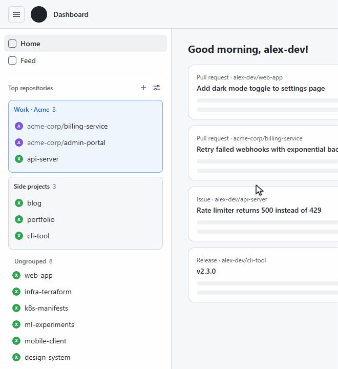
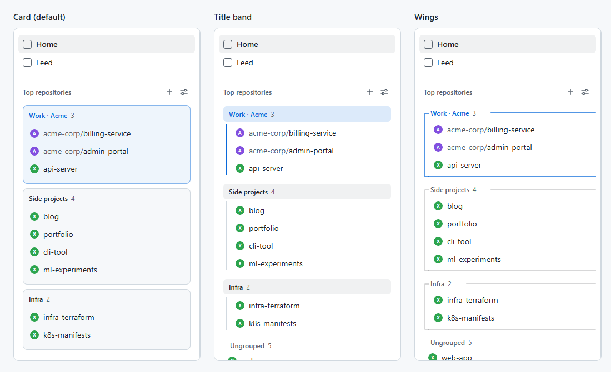

# Repo Grouping for GitHub

**Organize the repositories in GitHub's sidebar into folders and groups. Drag & drop, no login or token, stored locally.**

**English** | [简体中文](README.zh-CN.md)



GitHub's home page sidebar shows your **Top repositories** as one flat list. Once you have more than a handful of repos, it's hard to tell which is which or to find the one you need. GitHub has no built-in way to group repositories into folders ([the community has been asking since 2022](https://github.com/orgs/community/discussions/41348)).

Repo Grouping for GitHub is a browser extension that turns that sidebar list into **named groups you arrange yourself**: work projects together, side projects together, everything else under *Ungrouped*.

## Features

- **Groups right in the home page sidebar.** Works on `github.com`, `/dashboard` and `/feed`, where you already look for your repos.
- **Drag & drop.** Drag a repo into a group, reorder repos within a group, drag groups to reorder them. Or use the **⋯** menu next to any repo → *Move to group*.
- **Create groups on the fly.** Click **+**, or drop a repo on *Drop here to create a group* while dragging.
- **Collapse, rename, color.** Click a group's title to collapse it. Rename it, pick one of 7 colors, or delete it (its repos go back to *Ungrouped*).
- **Three styles.** *Card* (default), *Title band* and *Wings*. Switch in the toolbar popup or the sidebar's settings button.
- **No login, no token, nothing uploaded.** Groups stay in your browser on your computer, kept separately for each GitHub account.
- **Fails safe.** If GitHub changes its page or anything goes wrong, you get GitHub's original list back.
- **English and Chinese UI**, following your browser language.

## Group styles



## Install

**Chrome Web Store:** coming soon.

**Manual install (Chrome, Edge, Brave, Arc and other Chromium browsers):**

1. Download `repo-grouping-for-github-<version>.zip` from the [latest release](https://github.com/letheli710/repo-grouping-for-github/releases/latest) and unzip it (or clone this repository).
2. Open `chrome://extensions` (Edge: `edge://extensions`) and turn on **Developer mode**.
3. Click **Load unpacked** and select the `extension` folder.
4. Open or reload <https://github.com/>.

## How to use

| To do this | Do this |
|---|---|
| Create a group | Click **+** next to *Top repositories* |
| Put a repo in a group | Drag it onto the group, or hover it → **⋯** → *Move to group* |
| Create a group from a repo | While dragging, drop it on *Drop here to create a group* |
| Reorder | Drag repos within a group; drag a group's title to move the group |
| Collapse / expand | Click the group's title |
| Rename, color, delete | Hover the group's title → **⋯** |
| Change style | Click the extension's toolbar icon, or the settings button next to *Top repositories* |
| See GitHub's original list | Settings → *Also show GitHub's original list*, or disable the extension |

## Privacy & security

The extension is open source and has no server. In short: **it never sends your groups or repository names anywhere.**

| It does | It does not |
|---|---|
| Read the repository links in the home page sidebar (`/`, `/dashboard`, `/feed`) | Read your code, issues, cookies or tokens |
| Store group names, colors, order and `owner/repo` names in `chrome.storage.local`, separately for each GitHub account | Send data to the developer or any third-party server (no `fetch`, XHR, WebSocket or analytics in the code) |
| Click GitHub's own *Show more* button to load your full repository list | Star, follow, submit forms, call the GitHub API or change anything on GitHub |
| Reuse the same `avatars.githubusercontent.com` avatar images GitHub already shows | Load images or scripts from any other host |

**Permissions.** The only API permission is `storage`. To show groups on GitHub it also needs site access to `github.com`, so Chrome says it can *"read and change your data on github.com"* at install time. The script loads on github.com pages so it can notice when you navigate back to the home page, but it only reads the sidebar there.

**Multiple accounts.** Groups are stored per GitHub login. If you switch accounts in the same browser, you won't see the other account's groups. If no signed-in account is detected, the extension does nothing.

**Verifiable.** [`scripts/audit-extension.cjs`](scripts/audit-extension.cjs) loads the real extension in a temporary headless Chrome against a local mock of GitHub (no real account, every request intercepted). It checks zoom levels, window sizes, drag & drop, account isolation, save failures, XSS and which hosts get contacted. The full audit and how each finding was handled are in [`docs/security-and-edge-case-audit.md`](docs/security-and-edge-case-audit.md) (Chinese).

See also [PRIVACY.md](PRIVACY.md).

## FAQ

### Can I group repositories on GitHub?

Not natively. GitHub has Stars lists (public, only for starred repos), topics and organizations, but no folders or groups for the repositories in your sidebar. This extension adds them in the browser.

### How do I organize my GitHub repositories into folders?

Install the extension, open github.com, click **+** next to *Top repositories* to create a group, then drag repositories into it.

### Does it need a GitHub token or login?

No. It doesn't ask for a token, an OAuth login or an account of its own. It only reads what's already on the GitHub page you're signed in to.

### Is my data uploaded anywhere?

No. Groups are saved in your browser's local extension storage and never leave your computer. They don't sync between computers yet.

### Could using it get my GitHub account flagged?

It doesn't automate anything on GitHub. It doesn't call the API, scrape other pages, star or follow. The only action it takes is clicking GitHub's own *Show more* in the sidebar (at most 10 times, and only while new repos keep loading). That's ordinary page use, though nobody can promise how GitHub's systems behave.

### What if GitHub redesigns its home page?

The extension only takes over when it finds the sidebar list it expects. Otherwise it stays out of the way and you see GitHub's original list. Please [open an issue](https://github.com/letheli710/repo-grouping-for-github/issues) so it can be updated.

### Why isn't one of my repositories listed?

The extension works with the repositories GitHub shows in *Top repositories* (it expands the full list for you). A repo you haven't touched in a long time may not be in that list. Repos you've already put in a group stay visible.

### Does it work with multiple GitHub accounts?

Yes. Each account has its own groups. Settings (style, show original list) are shared.

### Which browsers are supported?

Chrome and other Chromium browsers (Edge, Brave, Arc, Opera). Firefox isn't supported yet.

## Compared with other options

As of November 2026, based on each tool's own store listing or docs:

| | Where your groups appear | How you sort repos | Needs an extra account | Open source |
|---|---|---|---|---|
| **Repo Grouping for GitHub** | Home page sidebar (*Top repositories*) | Drag & drop, or menu | No | Yes |
| GitHub Stars lists (built-in) | Your profile's Stars tab | Add starred repos to lists | No (lists are public) | – |
| GitHub topics (built-in) | Repository pages / search | Tag each repo | No | – |
| [GitFolders](https://chromewebstore.google.com/detail/gitfolders/jomibicoiciembfmjadghcnoomoefjpi) | A collapsible right-side panel | Create folders in the panel | A GitFolders account for sync | No source link found |
| [GitHub Repo Folders](https://chromewebstore.google.com/detail/omkhhmjinnijkbanpicofdceokjjlmni) | Your *Repositories* page | Per-repo dropdown | No | No source link found |

## Roadmap

- Import / export groups as JSON (backup, moving to a new computer)
- An *Add to group* button on repository pages, for repos not in *Top repositories*
- Firefox support

Ideas and bug reports are welcome in [Issues](https://github.com/letheli710/repo-grouping-for-github/issues).

## Development

```
extension/        the extension itself (Manifest V3, plain JavaScript, no dependencies, no build step)
  content.js      sidebar groups, drag & drop, storage
  popup.html/js   toolbar settings popup
  _locales/       store name and description (en, zh_CN)
scripts/
  audit-extension.cjs   automated checks in a temporary headless Chrome
  record-demo.cjs       records docs/images/demo.gif from demo/dashboard.html
  build-icons.cjs       renders extension/icons/*.png
demo/dashboard.html     local mock of the GitHub home page (fictional repos) used by the demo
docs/                   market research, design notes and security audit (Chinese)
```

The scripts need [Playwright](https://playwright.dev/) (point `NODE_PATH` at a `node_modules` that has it), an installed Chrome, and `ffmpeg` for the demo GIF:

```bash
node scripts/audit-extension.cjs
```

```bash
node scripts/record-demo.cjs
```

## License

[MIT](LICENSE)

*Repo Grouping for GitHub is an independent project. It is not affiliated with, endorsed by or sponsored by GitHub, Inc. "GitHub" is a trademark of GitHub, Inc.*
