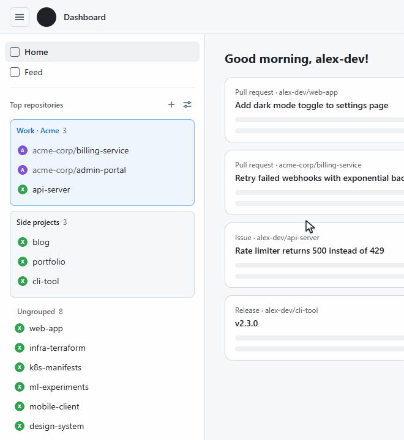
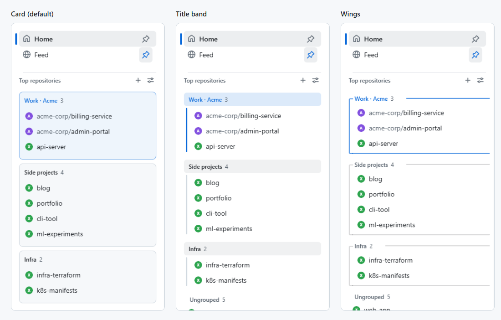

# Repo Grouping for GitHub

**把 GitHub 首页侧边栏里的仓库整理成分组。拖拽归类，不需要登录、不要 token，数据只存本机。**

[English](README.md) | **简体中文**



> 演示里的界面是英文。在中文浏览器里，扩展的按钮和菜单会自动显示中文。

GitHub 首页左侧的 **Top repositories** 是一条平铺的列表。仓库一多，就很难分清哪个是哪个，找起来也费劲。GitHub 本身不支持把仓库分组或放进文件夹，[社区从 2022 年就在提这个需求](https://github.com/orgs/community/discussions/41348)。

Repo Grouping for GitHub 是一个浏览器扩展，把这条列表变成**你自己命名、自己整理的分组**：工作项目放一组，个人项目放一组，其余的留在「未分组」。

## 功能

- **直接在首页侧边栏分组**：在 `github.com`、`/dashboard`、`/feed` 上生效，就在你平时找仓库的地方。
- **拖拽归类**：把仓库拖进分组、在组内调整顺序、拖动分组标题调整分组顺序。也可以点仓库旁的 **⋯** →「移到分组」。
- **随手建组**：点 **+** 新建分组；或者拖动仓库时放到「拖到这里新建分组」。
- **折叠、改名、配色**：点分组标题折叠或展开；可以重命名、选 7 种颜色之一，或删除分组（里面的仓库回到「未分组」）。
- **三种样式**：卡片（默认）、标题色带、长两翼。在工具栏弹出的设置面板，或侧边栏标题右边的设置按钮里切换。
- **不需要登录、不要 token、不上传数据**：分组只保存在这台电脑的浏览器里，并且按 GitHub 账号分开存放。
- **出问题时自动退回**：GitHub 改版或出错时，自动恢复 GitHub 原生列表。
- **中英双语界面**，跟随浏览器语言。

## 分组样式



## 安装

**Chrome 应用商店：** 即将上架。

**手动安装（Chrome、Edge、Brave、Arc 等 Chromium 内核浏览器）：**

1. 从[最新版本](https://github.com/letheli710/repo-grouping-for-github/releases/latest)下载 `repo-grouping-for-github-<版本号>.zip` 并解压（也可以直接克隆本仓库）。
2. 打开 `chrome://extensions`（Edge 是 `edge://extensions`），打开「开发者模式」。
3. 点「加载已解压的扩展程序」，选择 `extension` 文件夹。
4. 打开或刷新 <https://github.com/>。

## 用法

| 想做什么 | 怎么做 |
|---|---|
| 新建分组 | 点「Top repositories」右边的 **+** |
| 把仓库放进分组 | 拖到分组上；或悬停仓库 → **⋯** →「移到分组」 |
| 拖着仓库直接建组 | 拖动时放到「拖到这里新建分组」 |
| 调整顺序 | 在组内拖动仓库；拖动分组标题移动整个分组 |
| 折叠 / 展开 | 点分组标题 |
| 重命名、配色、删除 | 悬停分组标题 → **⋯** |
| 切换样式 | 点浏览器工具栏里的扩展图标，或「Top repositories」右边的设置按钮 |
| 看 GitHub 原生列表 | 设置 →「同时显示 GitHub 原生列表」，或停用扩展 |

## 隐私与安全

扩展开源，也没有服务器。一句话：**你的分组和仓库名不会被发送到任何地方。**

| 会做 | 不会做 |
|---|---|
| 读取首页（`/`、`/dashboard`、`/feed`）侧边栏里的仓库链接 | 读取你的代码、issue、cookie 或 token |
| 把分组名、颜色、顺序和 `owner/repo` 仓库名存进 `chrome.storage.local`，每个 GitHub 账号分开存 | 向开发者或任何第三方服务器发送数据（代码里没有 `fetch`、XHR、WebSocket 或统计） |
| 点击 GitHub 自己的「Show more」按钮，加载完整的仓库列表 | star、follow、提交表单、调用 GitHub API，或修改 GitHub 上的任何东西 |
| 复用 GitHub 页面上已经显示的 `avatars.githubusercontent.com` 头像 | 从其他任何地址加载图片或脚本 |

**权限：** 唯一的 API 权限是 `storage`。为了在 GitHub 页面上显示分组，还需要 `github.com` 的网站访问权限，所以安装时 Chrome 会提示「读取和更改您在 github.com 上的数据」。脚本会在 github.com 各页面加载，这样从其他页面回到首页时它能察觉到，但只会读取首页侧边栏。

**多账号：** 分组按 GitHub 登录名分开存放。同一个浏览器里换账号，看不到另一个账号的分组。页面上检测不到登录账号时，扩展什么都不做。

**可以验证：** [`scripts/audit-extension.cjs`](scripts/audit-extension.cjs) 会在临时的无头 Chrome 里，用本地仿造的 GitHub 页面加载真实扩展。整个过程不用真实账号，所有请求都在本地拦截。检查项包括缩放、窗口尺寸、拖拽、账号隔离、保存失败、XSS，以及扩展访问了哪些地址。完整的审查报告和每个问题的处理记录见 [`docs/security-and-edge-case-audit.md`](docs/security-and-edge-case-audit.md)。

另见 [PRIVACY.md](PRIVACY.md)。

## 常见问题

### GitHub 能给仓库分组吗？

原生不行。GitHub 有 Stars lists（必须公开，而且只能放 star 过的仓库）、topics 和组织，但侧边栏里的仓库没有文件夹或分组功能。这个扩展在浏览器里把它补上。

### 怎样把 GitHub 仓库整理进文件夹？

安装扩展后打开 github.com，点「Top repositories」右边的 **+** 新建分组，再把仓库拖进去。

### 需要 GitHub token 或登录吗？

不需要。不要 token，不走 OAuth 授权，也不需要注册扩展自己的账号。它只读取你已经登录的 GitHub 页面上本来就有的内容。

### 我的数据会被上传吗？

不会。分组保存在浏览器本地的扩展存储里，不会离开你的电脑。暂时也还不能在多台电脑之间同步。

### 会不会导致 GitHub 账号被封？

它不在 GitHub 上做任何自动化操作：不调用 API、不抓取其他页面、不 star 也不 follow。唯一的动作是点击侧边栏里 GitHub 自己的「Show more」，最多 10 次，而且只在有新仓库加载出来时才继续点。这属于正常的页面使用，不过谁也无法保证 GitHub 的系统会怎么判断。

### GitHub 改版了怎么办？

扩展只在找到它认识的侧边栏列表时才接管，否则就不动，你看到的是 GitHub 原生列表。遇到这种情况请[提交 issue](https://github.com/letheli710/repo-grouping-for-github/issues)，以便尽快适配。

### 为什么我的某个仓库没出现？

扩展处理的是 GitHub 在「Top repositories」里列出的仓库，它会自动帮你展开完整列表。很久没动过的仓库可能不在这个列表里。已经放进分组的仓库会一直显示。

### 支持多个 GitHub 账号吗？

支持。每个账号有自己的分组；设置（样式、是否显示原生列表）所有账号共用。

### 支持哪些浏览器？

Chrome 和其他 Chromium 内核浏览器（Edge、Brave、Arc、Opera）。暂不支持 Firefox。

## 和其他方案对比

截至 2026 年 11 月，依据各工具自己的商店页或文档：

| | 分组显示在哪 | 怎么归类 | 需要额外账号 | 开源 |
|---|---|---|---|---|
| **Repo Grouping for GitHub** | 首页侧边栏（Top repositories） | 拖拽，或菜单 | 不需要 | 是 |
| GitHub Stars lists（内置） | 个人主页的 Stars 标签 | 把 star 过的仓库加进列表 | 不需要（列表是公开的） | – |
| GitHub topics（内置） | 仓库页面 / 搜索 | 给每个仓库打标签 | 不需要 | – |
| [GitFolders](https://chromewebstore.google.com/detail/gitfolders/jomibicoiciembfmjadghcnoomoefjpi) | 可收起的右侧面板 | 在面板里建文件夹 | 同步需要注册 GitFolders 账号 | 没找到源码链接 |
| [GitHub Repo Folders](https://chromewebstore.google.com/detail/omkhhmjinnijkbanpicofdceokjjlmni) | 个人的 Repositories 页面 | 每个仓库旁的下拉框 | 不需要 | 没找到源码链接 |

## 后续计划

- 分组导入 / 导出为 JSON（备份、换电脑）
- 在仓库页面加「加入分组」按钮，用于不在 Top repositories 里的仓库
- 支持 Firefox

欢迎在 [Issues](https://github.com/letheli710/repo-grouping-for-github/issues) 里提建议和报告问题。

## 开发

```
extension/        扩展本体（Manifest V3，原生 JavaScript，无依赖，无需构建）
  content.js      侧边栏分组、拖拽、存储
  popup.html/js   工具栏设置面板
  _locales/       商店名称和描述（en、zh_CN）
scripts/
  audit-extension.cjs   在临时无头 Chrome 里跑自动检查
  record-demo.cjs       加载真实扩展，录制 docs/images/demo.gif 和截图
  snapshot-dashboard.js 在 github.com/dashboard 的浏览器控制台运行，生成 1:1 页面副本，
                        账号、仓库和 PR 都会换成虚构内容（副本不进 git）
  build-icons.cjs       生成 extension/icons/*.png
demo/
  dashboard.html        手写的备用仿 GitHub 首页（仓库都是虚构的）
  cursor-overlay.js     在录像里画出鼠标指针
docs/                   市场调研、产品设计和安全审查（中文）
```

脚本需要 [Playwright](https://playwright.dev/)（用 `NODE_PATH` 指向装有它的 `node_modules`）、本机安装的 Chrome，录制动图还需要 `ffmpeg`：

```bash
node scripts/audit-extension.cjs
```

```bash
node scripts/record-demo.cjs
```

## 许可证

[MIT](LICENSE)

*Repo Grouping for GitHub 是独立项目，与 GitHub, Inc. 没有关联，也未获得其认可或赞助。「GitHub」是 GitHub, Inc. 的商标。*
